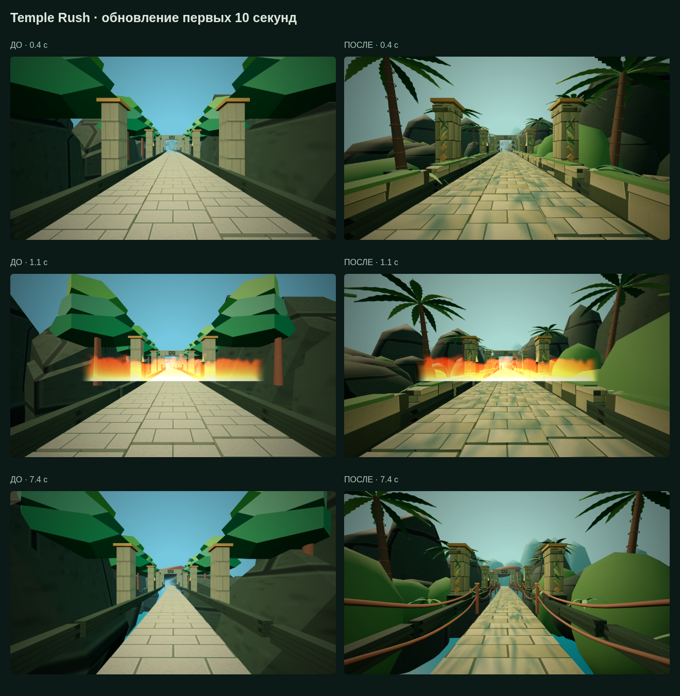

# Fitness Arcade — Temple Rush

A three-minute first-person fitness run, built on prototype `6d5cc21ffb5fe746950a54177a2d520fbc2f318a`.

## Play

Serve `index.html` over HTTPS for phone camera access. On a desktop, run `python3 -m http.server 8081` and visit `http://localhost:8081`.

1. Enable Camera, allow access, and stand fully in view until calibration says ready.
2. Choose jumping or low-impact mode, then start. Every session lasts 180 active seconds; misses deduct points and reset the combo without ending the run.
3. Jog in place to move the scenery. Stop to slow it down. Follow squat, dodge, jump, punch, and other movement cues. The final screen gives accuracy, best combo, points and a rank.

Camera processing stays on the device. MediaPipe code and the pose model download from CDN/Google on camera activation. Existing gesture mappings are retained, with alternating-knee running and jump detection added. Those heuristics still need calibration and validation on a real iPhone 11; synthetic pose tests are not a physical-device test.

## LG TV via AirPlay

Put the iPhone in landscape orientation. Connect it and the LG TV to the same Wi-Fi, use iOS Control Center → Screen Mirroring, and select the TV. In the game, choose **Экран ТВ** to hide the desktop controls and frame the 16:9 scene. The exit button restores controls. AirPlay and camera capture together, actual screen filling, latency and sustained performance must be tested on the iPhone 11 / OLED55A23LA pair. This is screen mirroring, not a separate webOS receiver or a native iOS app.

## Desktop controls

R / Run button: running pulse (hold R for continuous jogging). Arrow keys: dodge, squat and jump. Space: punch. W: knee lift. J: jack. F: arm sweep. B: block. P/Escape: pause.

## Browser regression check

With the local server running and Playwright installed:

```sh
CHROMIUM_PATH=/usr/bin/chromium node tests/run.cjs
```

Omit `CHROMIUM_PATH` to use Playwright's own browser. `TEST_URL` overrides the local URL. Covers nonfatal misses, complete-session timing, movement start/stop, punch feedback, boss defeat, result/reset, pause and synthetic camera input. Produces impact/result/mobile screenshots.

## 3D visual slice (0.3)

The route now renders using a vendored Three.js r160.1 build (MIT; license in `vendor/THREE-LICENSE.txt`). Original procedural stone, canopy, gateway, hanging vines, torchlit walls and a curved centreline replace the flat runway. Camera movement reflects duck/jump/dodge inputs. The first 30 seconds are the visual review slice; later gameplay and the existing 2D boss remain prototype material. No footage, brands or artwork from the reference videos are bundled.

Run `node tests/scene.cjs` for separate WebGL smoke checks and jungle/gate/temple screenshots (system Chromium at `/usr/bin/chromium`). The gameplay regression intentionally stubs rendering after initial load to isolate game rules from software-GPU frame rate. Real iPhone performance, AirPlay and pose recognition remain unverified.

## Route tasks (0.5)

Successful LEFT/RIGHT/JUMP/STEP cues collect a visible relic (+50 bonus); a wrong move or missed cue earns none. The HUD and result report relic count. Jump/step cues display a turquoise landing pad beyond the obstacle. Low-impact mode continues to convert jumps to steps.

At 52 seconds the watcher warns the player; from 54 to 58 seconds it asks them to freeze. After a 0.8-second settling period, accumulate 2.2 consecutive still seconds to earn one relic and 300 points. Movement resets the hold. No early game-over on failure. In camera mode the trial requires a calibrated, visible, fresh pose and eight visible joints (shoulders, hips, wrists, knees). Average joint speed is normalized by torso length; the current threshold is a heuristic pending real-device tuning. Missing or stale camera data never earns stillness credit. In button mode release movement controls; this is a demonstration fallback, not verification of physical stillness.

`node tests/tasks.cjs` checks matching/mismatching actions, collection, freeze input suppression, successful hold, camera loss and hold reset. The approved guardian concept still awaits an actual rigged model; the watcher is a separate temple idol, not a replacement for that design.

## Reference route (0.6)

The opening now follows the supplied 30-second reference: fire bars, floor fire, logs, spikes, a rolling obstacle, side pillars and jumps through ruins, a jungle bridge and a glowing crystal cave. Sixteen timed cues replace the slower opening encounter. Camera height and banking respond to duck, jump and dodge. The rejected humanoid guardian placeholder is hidden; its approved replacement model is still pending.

Choose **ПРОСМОТР ТРАССЫ · 30 С** to watch the opening at nominal speed without camera input. This demonstration automatically performs the actions and returns to the menu. In a normal run movement remains player-controlled and low-impact mode changes jumps to steps.

The reference is a filmed TV, so this is a reconstruction of its sequence and pace with original procedural art. See [the timing and validation notes](docs/reference-route.md) for scope and limits.

```sh
node tests/route.cjs
TEST_URL=http://127.0.0.1:8084 node tests/choreography.cjs
TEST_URL=http://127.0.0.1:8084 node tests/scene.cjs
```

## Opening environment polish (0.7)

The first 120 route metres (about 12 seconds at nominal speed) add curved palm fronds, ferns, layered masonry with bevels and moss, carved gateway medallions, rope bridge rails and a distant mountain silhouette. The detail geometry lives in `world-detail.js`. A deterministic 512px stone texture includes colour variation and small bump detail. Soft canopy shade is a baked alpha mask on the track, not real volumetric lighting or dynamic shadow maps.

Static batches are split into 96m sections to permit frustum culling. The lane remains open and the existing cue times, actions and scoring are unchanged. The new style is still procedural and stylized; this is an initial improvement over the angular tree crowns, not reference-quality art. Physical iPhone 11 performance is not yet measured.



## Ground fire correction (0.7.1)

Fire now rises from a charred strip on the track. The two former floating-fire cues at 1.35s and 26.6s require a jump (a step in low-impact mode); overhead logs and stone bars still require ducking. Timings are unchanged.
